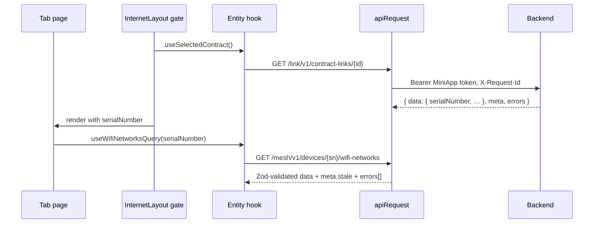

# System architecture

## Scope

This repository contains the frontend of the "Internet" (Wi-Fi Mesh) miniapp embedded in the MyHome
Flutter super app. It consumes the MyHome backend API described by `contracts/openapi.yaml` (LLD) and is
isolated from ONE Link / OneGate / OneBSS: device commands and upstream credentials stay in the backend.

## Runtime shape

```text
MyHome super app (Flutter)
      │  WebView + MyHome JSBridge (getMiniAppToken, getWifiInfo, measureWifiSpeed, …)
      ▼
Internet miniapp (this repo, static hash-routed bundle)
      │  HTTPS, CF envelope, Bearer MiniApp token
      ▼
MyHome backend  /link/v1/*  /mesh/v1/*
      │
      ▼
OneBSS (contracts) · OneGate/ONE Link (ONT, Wi-Fi, clients, commands)
```

## Information architecture

One "Internet" screen with a header (title + X → `closeMiniApp`), the contract card and four pill tabs.
Detail screens are sub-pages with a back button; quick actions are bottom sheets/dialogs.

| Route                       | Screen                                                                        | Slice                       |
| --------------------------- | ----------------------------------------------------------------------------- | --------------------------- |
| `#/` → last tab or `/wifi`  | Redirect (`localStorage.lastTab`)                                             | `app/layout`                |
| `#/wifi`                    | Wi-Fi health by location (measure, history, Mesh hint) + Wi-Fi network list   | `pages/wifi-tab`            |
| `#/wifi?sheet=wifi-options` | Options sheet: on/off, rename/password, copy password, share QR               | `widgets/wifi-network-list` |
| `#/wifi/:wifiIndex/edit`    | Rename / change password                                                      | `pages/wifi-network-edit`   |
| `#/wifi/:wifiIndex/share`   | Wi-Fi QR code                                                                 | `pages/wifi-network-share`  |
| `#/devices`                 | Connected devices with filter chips (`?filter=`, `?sort=traffic&focus=<mac>`) | `pages/devices-tab`         |
| `#/devices/:mac`            | Device detail: block/unblock, remove                                          | `pages/device-detail`       |
| `#/devices/:mac/edit`       | Rename + icon                                                                 | `pages/device-edit`         |
| `#/modem`                   | ONT info, inline rename, reboot                                               | `pages/modem-tab`           |
| `#/quality`                 | 3-step line check (line → Wi-Fi → devices), result actions                    | `pages/quality-tab`         |
| no contract                 | "Chưa có dịch vụ" carousel + VNPT Shop CTA                                    | `pages/no-internet-service` |

Pre-redesign deep links redirect with `replace`: `/clients`, `/clients/:id` → `/devices`; `/health` →
`/wifi`; `/diagnostics` → `/quality`; `/mesh` → `/modem` (`legacyRedirects` in `shared/config/routes.ts`).

## Frontend layers

Feature-Sliced Design, enforced by `eslint-plugin-boundaries`:

```text
app → pages → widgets → features → entities → shared
```

- `app/`: composition root — providers, router, layouts (`InternetLayout`, `SubPageLayout`, contract
  gate), MSW aggregation (`app/mocks`), global styles and tokens.
- `pages/`: one slice per route; composition only.
- `widgets/`: composite blocks reused across pages/layouts — `contract-card`, `contract-scope`
  (`RequireSerialNumber`), `wifi-network-list`, `wifi-health-section`.
- `features/`: one user action per slice — `toggle-wifi-network`, `update-wifi-network`,
  `reveal-wifi-password`, `share-wifi-qr`, `manage-measurement-location`, `measure-wifi-signal`,
  `block-connected-device`, `remove-connected-device`, `edit-connected-device`, `rename-ont`,
  `reboot-ont`, `run-health-check`, `report-fault`.
- `entities/`: LLD resources — `contract` (P1), `ont-device` (P5), `wifi-network` (P3),
  `connected-device` (P4), `measurement-location` (P2), `health-check` (P6), `command` (P0-04). Each has
  `model/` (Zod schemas with a compile-time `AcceptsContract` check against the generated types),
  `api/` (API functions, key factory, hooks, MSW handlers), `index.ts` (runtime entry) and `mock.ts`
  (mock-only entry).
- `shared/`: `api` (CF client, errors, commands, idempotency, MSW helpers), `super-app` (bridge),
  `session`, `i18n`, `config`, `lib`, `ui` (design-system primitives), `test`.

Same-layer cross-slice imports and deep imports are lint errors.

## Provider tree

```text
ErrorBoundary
└── AppProviders
    └── SuperAppProvider            (useSuperApp(); injectable in tests)
        └── QueryProvider           (TanStack Query client)
            └── SessionProvider     (host locale via legacy getSession, 5 s best effort, falls back to vi-VN)
                └── I18nProvider
                    └── ToastProvider
                        └── RouterProvider (hash router)
                            ├── InternetLayout  → contract gate → tabs
                            └── SubPageLayout   → contract gate → detail pages
```

## Data flow: contract → serial number

All data is scoped by the selected contract and its ONT (LLD §3, §5):

1. `GET /link/v1/contract-links` lists the user's contracts; with several, the user picks one
   (`POST …/select`, idempotent).
2. `GET /link/v1/contract-links/{contractId}` returns the detail, including the ONT `serialNumber`
   (may be `null`, B-01 → "Chưa xác định được modem của hợp đồng").
3. `useSelectedContract()` exposes `{ status, contract, detail, serialNumber }`. Layouts gate on
   `status` (`loading | error | none | unselected | ready`); tab content that needs the modem wraps
   itself in `RequireSerialNumber`.
4. Device data lives under `/mesh/v1/devices/{serialNumber}/…` (`ont-device`, `wifi-network`,
   `connected-device`, `health-check`, `command`), location data under the contract
   (`measurement-location`).

Query keys start with `['contract', contractId]` or `['device', serialNumber]`
(`shared/lib/query-scope.ts`), so switching contract never mixes cached data.



## HTTP seam (`shared/api`)

`apiRequest({ path, method, schema, query, body, contentType, idempotencyKey, signal, timeoutMs })`:

- parses the CF envelope `{ data, meta?, errors? }` and validates `data` with Zod (mismatch →
  `ApiError { code: 'INVALID_RESPONSE' }`);
- maps error bodies `{ error: { code, message, traceId, retryable, retryAfterSec?, details? } }` to
  `ApiError` (non-CF bodies → `HTTP_<status>`; transport → `NETWORK_ERROR` / `CLIENT_TIMEOUT`);
- sends `Authorization: Bearer <MiniApp token>`, `X-Request-Id`, `X-Client-Version`,
  `Idempotency-Key` (writes) and `Content-Type` (`application/json` / `application/merge-patch+json`);
- on `401` asks the bridge for a new token and retries once with the same idempotency key; a second
  `401` (or a failed token refresh) calls `closeMiniApp`, single-flight. The token lives in memory only (`createTokenManager`).

`error.message` is never shown: `useErrorMessage()` maps codes to the `errors` namespace.
`shouldRetryQuery` retries network/5xx but never `409`, `429` or responses carrying `retryAfterSec`.

Partial responses (LLD §11.4) render `StaleNotice` for `meta.stale` and `SectionError` only in the
block whose `errors[].target` failed.

### Idempotency

Every write sends an `Idempotency-Key` chosen per user action (`useIdempotencyKey().forAction(input)`),
carried in mutation variables (`IdempotentVariables`) and reused when the same action is retried after
a network error or `401`. A new key is generated only when the user changes the input or confirms a new
action.

### Async commands

Modem writes (Wi-Fi PATCH, block/unblock/remove client, rename, reboot, enable Wi-Fi) answer
`202 + Location: /mesh/v1/commands/{id}` with a `Command`. `useCommandPoller` (entity `command`) re-reads
it every `retryAfterSec` (default 2 s) until `CONFIRMED` / `FAILED`, giving up after 2 min (reboot 6 min).
`UNKNOWN` and a network loss right after the `202` (the phone may have left the Wi-Fi it just changed)
mean "sent, waiting for the modem", not an error. Toggles are optimistic and roll back on `FAILED`.
`useActiveCommands(serialNumber)` resumes tracking after reopening the miniapp. Health checks follow
the same pattern (`POST 202` → poll every 3 s, max 3 min).

## Super-app seam (`shared/super-app`)

`SuperAppClient` = the LLD `MyHomeBridge` (`getMiniAppToken`, `closeMiniApp`, `getAppInfo`,
`getNetworkInfo`, `getWifiInfo`, `measureWifiSpeed`, `readWifiRssi`, `onNetworkChange`, `openDeeplink`,
`openPayment`, `saveImage`, `shareImage`, `copyText`, `supports`) plus the legacy `getSession` used only
for the locale. `guardBridge` adds `supports()` checks, timeouts and error normalisation. Production uses
the Flutter adapter; `npm run dev` uses the browser mock adapter. Details:
[super-app-integration.md](./super-app-integration.md).

Wi-Fi measurement (`features/measure-wifi-signal`) selects a meter from the platform and
`GET /mesh/v1/signal-thresholds → androidMethod`: Android SPEED (`measureWifiSpeed`) or RSSI
(`readWifiRssi`), falling back to the other and then to manual input; iPhone always uses manual RSSI
entry from AirPort Utility.

## Mock strategy (MSW)

`VITE_API_MODE=mock` lazily starts the MSW service worker before rendering (`src/main.tsx`,
`src/app/mocks/browser.ts`); remote builds drop the chunk (verified by `npm run size`). Handlers live
with each entity (`entities/<slice>/api/mock-handlers.ts`, exported from `mock.ts`) and are aggregated in
`src/app/mocks/handlers.ts`. `src/shared/api/mock/` holds the building blocks:

- envelope/error helpers, ownership and offline guards (`checkAuth`, `checkContract`, `checkDevice`);
- an `Idempotency-Key` store (400 without key, replay with `Idempotent-Replayed: true`, 422 on reuse with
  another body);
- an async command store (SENT → CONFIRMED after ~2 s, reboot ~8 s; outcome can be forced to `FAILED`
  or `UNKNOWN`; device lock → `409 DEVICE_BUSY`; reboot limit 3 / 30 min → `429`);
- scenario flags `VITE_MOCK_CONTRACTS | SERIAL | SURVEY | HEALTH | DEVICE | ANDROID_METHOD`
  (see README), switchable in tests with `setMockScenario()` + `resetMockDb()`.

Fixtures are typed with the generated contract (`ApiSchemas['…']`), so `npm run gen:api` breaks
typecheck when they drift; `src/app/test/mock-contract.test.ts` parses every fixture with the runtime
schemas and calls every endpoint for several scenarios. In Vitest, `src/app/mocks/setup-mock-server.ts`
starts the MSW node server for every test (unhandled `/mesh/v1` or `/link/v1` requests fail the test)
and resets scenario, mock DB and cached token after each test.

## Internationalization

Bundled `vi` resources only (no runtime download); unsupported locales fall back to `vi`. Namespaces:
`common` (shell, states, route titles), `internet` (layout, contract card, no-service), `wifi`, `survey`,
`devices`, `modem`, `quality`, `errors` (every contract `ErrorCode`, bridge and client error, HTTP
fallback; completeness is tested).

## Design system

Colours, spacing, typography, radius, shadow and motion are CSS custom properties in
`src/app/styles/tokens.css`; `npm run lint:tokens` rejects hex colours elsewhere. Primitives live in
`shared/ui` (Button, IconButton, BottomSheet and Dialog on native `<dialog>`, Toast, Switch,
SegmentedTabs, Chip, TextField, ListRow, Accordion, SignalBars, Skeleton, SpecNote…). Icons come from
`lucide-react`. The font is self-hosted Be Vietnam Pro 400/600/700, latin + vietnamese subsets
(`src/app/styles/fonts.css`). `SpecNote` marks details pending partner confirmation
(`shared/config/pending-spec-notes.ts`), visible in mock mode.

## Quality gates

`format:check`, `lint` (boundaries), `lint:tokens`, `typecheck`, `test:coverage` (60 % global; 70 % for
`shared`, `entities`, `features`, `widgets`), an axe audit of every tab, sub-page and sheet
(`src/app/test/a11y.test.tsx`), `build`, and `size` (remote build: entry ≤ 180 kB gzip, any other chunk
≤ 60 kB gzip, no MSW). All run in CI (`.github/workflows/ci.yml`).
